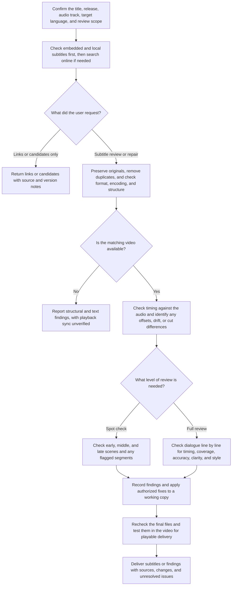

# subtitle-workflow

A Codex skill for finding and reviewing multilingual subtitles for films and TV series. It looks for subtitles that match your video release, checks timing, missing lines, and translation quality, and flags anything that still needs review while preserving the original files.

[Download v1.4.0](https://github.com/GreyGu/subtitle-workflow/releases/download/v1.4.0/subtitle-workflow-1.4.0.zip) · [Releases](https://github.com/GreyGu/subtitle-workflow/releases) · [Report an issue](https://github.com/GreyGu/subtitle-workflow/issues)

## Install and get started

1. Download and extract the ZIP. Copy the entire `subtitle-workflow` folder into `%USERPROFILE%\.agents\skills\` on Windows or `~/.agents/skills/` on macOS and Linux. For a project-only installation, use the project's `.agents/skills/` directory. When upgrading, back up the old folder outside the skill discovery directories before replacing it.
2. Check that the installed folder contains `subtitle-workflow/SKILL.md` under `.agents/skills/`. Type `$subtitle-workflow` in Codex to select the skill. If it does not appear, restart Codex.
3. Replace the placeholders in this prompt with your details.

> Use $subtitle-workflow to find Simplified Chinese subtitles for [video path]. The audio track is in [source language]. Check that the subtitles match this release and spot-check the timing and missing lines. Save the results to [output directory], preserve the original files, and list anything that still needs review.

Ask for a **full review** if you want a line-by-line check. Without the video, the skill can still find candidates and review subtitle text, with playback sync marked as unverified.

## How it works



## Try the included sample

Run both commands from the extracted `subtitle-workflow` folder. The scripts require Python 3.10 or later and use only the Python standard library. If needed, substitute `py -3` on Windows or `python3` on macOS and Linux for `python`.

```sh
python -B -X utf8 scripts/subtitle_audit.py audit assets/examples/zh-en/target.en.srt
python -B -X utf8 scripts/subtitle_audit.py map-check --target assets/examples/zh-en/target.en.srt --reference assets/examples/zh-en/source.zh.srt --mapping assets/examples/zh-en/review-map.json --require-quality-review
```

The first command checks the English SRT file, a plain-text subtitle format, for encoding, timing, and cue structure. The second checks the cue-by-cue mapping from the Chinese reference to the English subtitles and verifies that the required review records are complete. The sample uses original dialogue and runs without a video, an account, or an internet connection. Assessing sync and translation for a real film requires the audio and scene context.

## Features and tools

| Task | What the skill does |
| --- | --- |
| Find subtitle candidates | Filter by title, episode, release, and audio track. Online search and downloads depend on the tools available to Codex and access to the source site. |
| Audit SRT files | Check timing, empty cues, and coverage against a reference when provided. Checks are read-only by default. Explicit exports write to new files. |
| Review sync and translation | Check for missing lines, mistranslations, and style issues against the audio and scene context. Use FFmpeg, ffprobe, or a media player as needed. |
| Track series and multilingual jobs | Use `subtitle_progress.py` to track progress by episode, identify duplicate candidates, and reuse results when the inputs match. |

The bundled checker supports SRT. Styled ASS/SSA subtitles and bitmap-based PGS/SUP subtitles use format-specific tools. The translation direction follows the actual audio track and requested target language.

## Test and package

```sh
python -B -X utf8 -m unittest discover -s scripts -p "test_*.py" -v
python -B -X utf8 scripts/package_skill.py build --output dist/subtitle-workflow-1.4.0.zip
python -B -X utf8 scripts/package_skill.py verify dist/subtitle-workflow-1.4.0.zip
```

The archive contains only files on the packaging list. The verifier checks file membership, version, and SHA-256 file hashes against the manifest. See the [script reference](references/script-usage.md) for options and exit codes and [SKILL.md](SKILL.md) for the instructions Codex follows.

## Feedback and license

When reporting an issue, include the skill version, operating system, command, and error message with private paths removed. Use original sample dialogue to reproduce subtitle issues where possible.

The source, documentation, and original samples are available under the [MIT License](LICENSE).
